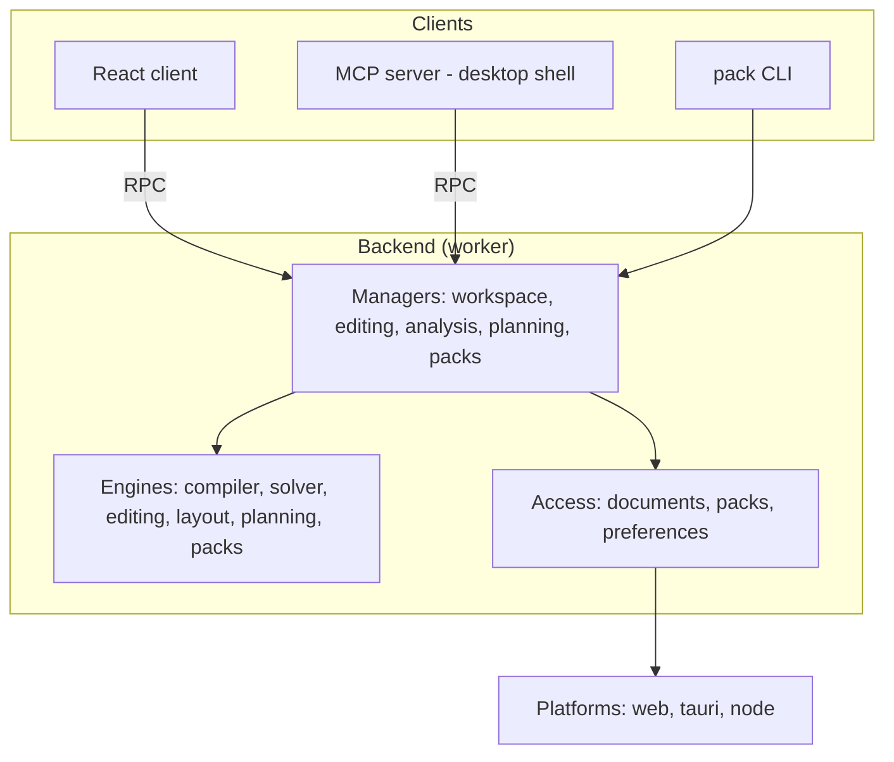
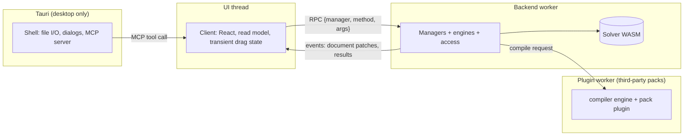

# Architecture

Carbonara is decomposed by volatility, following the iDesign Method. Each component hides one thing that is likely to change, and calls only go down. Features are not components: a feature is a sequence of calls through the components (a *use case*), and that sequence belongs to a manager.

[TOC]

## Areas of change

These are the things we expect to change independently, and where each one is contained. A component that hides two of these should be split; two components that change for the same reason should be merged.

| What may change | Example | Contained in |
| --- | --- | --- |
| The games and their rules | A new game, a game patch changes recipes, a new mechanic | Game packs (data + plugin), applied by the `compiler` engine |
| How a factory is solved | Another LP backend, better decomposition, subgraph summaries | `solver` engine (Rust → WASM) |
| How graphs are edited | Paste semantics, delete & bridge, collapse to subgraph | `editing` engine |
| How graphs are laid out | ELK today, our own layered layout tomorrow | `layout` engine |
| How goals become factories | Which recipes to consider, how proposals are shaped | `planning` engine |
| What makes a pack valid | Schema versions, engine ranges, lint rules | `packs` engine |
| Where documents, packs and settings are stored | IndexedDB, OPFS, files, share links, bundled packs | `documents`, `packs`, `preferences` access |
| The machine | Browser APIs, Tauri commands, Node (CLI) | Platforms, behind ports |
| Who is asking | The UI, an MCP client, the pack CLI, tests | Clients, which call managers only |
| How the canvas is drawn | React Flow, later perhaps WebGL | The client's `CanvasAdapter` |
| The steps of a use case | Open a document → load its pack → solve | Managers |

## Layers



| Layer | Folder | Hides | May use |
| --- | --- | --- | --- |
| Contracts | `src/contracts/` | Nothing: the types every layer agrees on. These are zod schemas for packs and documents, the solver IR, the plugin API, the manager contracts and the RPC envelope | — |
| Utilities | `src/utilities/` | Generic helpers: ids, hashing, rationals, units, queues, results | contracts |
| Engines | `src/engines/` | Business rules (see the table above). Pure functions only: no I/O, no clock, no randomness unless injected | contracts, utilities |
| Access | `src/access/` | Where things are stored and in what format | contracts, utilities, platform ports |
| Managers | `src/managers/` | The use cases. One manager per area of change of the workflows | engines, access, contracts, utilities |
| Platforms | `src/platforms/` | The machine: browser storage and file APIs, Tauri commands, Node `fs` | contracts |
| Client | `src/client/` | The user interface | contracts, utilities; reaches managers only through its connector |
| Shells | `src/shells/` | The runtime: web bootstrap, Tauri window, menus, file associations, the MCP server | everything below |

**Call rules**, which ESLint enforces (see [[Development]]):

- Calls go down only. Engines never call other engines and access components never call other access components; the manager orchestrates.
- Managers never call other managers. When a use case in one area affects another, the manager publishes an event (for example `editing` publishes `documentChanged`, which `analysis` listens to).
- Clients call managers and nothing else. That's what makes the UI, MCP and the CLI interchangeable.
- The Rust solver is an engine. Its TS facade in `src/engines/solver/` is the only code that knows WASM exists.

## Managers

| Manager | Use cases |
| --- | --- |
| `workspace` | Create, open, save and close documents; tabs; autosave; recent documents; import/export; share links; preferences |
| `editing` | Apply commands (add, connect, move, delete, set fields …); undo/redo and history; copy and paste; collapse and expand subgraphs; align and auto-arrange; apply proposals |
| `analysis` | Solve when a document changes; per-node results; diagnostics; totals; explain a node; convert rates ("2 yellow belts" → items/min) |
| `planning` | Goals → proposals; compare recipes |
| `packs` | List, install, trust and remove packs; validate; load a dev folder and reload it on change; import game data; build a `.cpack` |

Every manager method is declared once in [[src/contracts/managers.ts]]: its zod argument schema, the type it resolves to, and, if it's exposed to MCP, its tool name, permission group and description. Everything else is derived from that table:

- the **dispatcher** in front of the managers ([[src/utilities/rpc.ts]] `createDispatcher`) validates arguments and turns unknown methods and exceptions into error responses, so managers can sit directly behind RPC or MCP;
- the **client connector** (`connect`, wrapped by [[src/client/core/connector.tsx]]) is a typed proxy with the same method names;
- the **MCP tools** ([[Architecture/MCP server]]).

Managers implement `ManagerImplementation<"name">` and receive validated arguments with defaults filled in. Methods return `Result` for expected failures (an invalid file, a broken pack) and throw only on bugs. Add a method to the contract when a use case needs it, not before.

Access components that several managers share have their interfaces in [[src/contracts/access.ts]]: the `DocumentStore` (documents open in this session) and the `PackStore` (built-in and installed packs, loaded with their plugins).

The **composition root** is [[src/shells/web/backend.ts]]: it creates the managers with their access components and platform, and serves them on the backend worker's port ([[src/shells/web/backend.worker.ts]]).

**Events** (`Events` in the same file) are published on the backend's event bus ([[src/utilities/events.ts]]). Managers subscribe to each other's events instead of calling each other, and the composition root forwards every event to the clients: `documentChanged` (Immer patches and the new version), `documentsChanged`, `resultsChanged` and `packsChanged`. Edits are sent as `Command`s ([[src/contracts/commands.ts]]) to `editing.apply`; a batch is one undo step.

## Threads and processes



- **UI thread:** the client keeps a *read model*: a mirror of the open documents plus the latest results. It's updated from manager events (Immer patches and typed-array result deltas). While you drag something, the client moves it locally and sends one `editing.moveNodes` command when you drop it.
- **Backend worker:** managers, engines, access and the solver's WASM module. Calls use the RPC envelope from [[src/contracts/rpc.ts]]: `{ id, manager, method, args }` → `{ id, ok: true, value } | { id, ok: false, error }`, plus `{ event, payload }` messages.
- **Plugin worker:** built-in packs run their plugin inside the backend worker. Third-party pack code runs in a separate worker with an opaque origin, so it can't reach our storage; the compiler engine runs there for those packs (see [[Architecture/Plugins]]).
- **Tauri:** platform calls that need the main thread (dialogs, Tauri commands) are proxied through the client's connector. The MCP server is part of the Tauri shell and forwards each tool call as an ordinary manager call.

## Folder layout

```
carbonara/
├─ src/
│  ├─ contracts/      # zod schemas, IR types, plugin API, manager contracts, RPC
│  ├─ utilities/
│  ├─ engines/        # compiler/ solver/ editing/ layout/ planning/ packs/
│  ├─ access/         # documents/ packs/ preferences/
│  ├─ managers/       # workspace analysis editing planning packs + backend composition root
│  ├─ platforms/      # web/ tauri/ node/
│  ├─ client/         # core/ (connector, read model) ui/ (design system) canvas/ features/
│  └─ shells/         # web/ (bootstrap, worker entry) tauri/src-tauri/ (Rust shell + MCP)
├─ crates/
│  ├─ solver/         # LP model, decomposition, subgraph compiler (native, tested with proptest)
│  └─ solver-wasm/    # wasm-bindgen bindings
├─ packs/             # _template/, satisfactory/, factorio/ → each builds into one .cpack
├─ tools/pack-cli/    # `carbonara-pack`, a client of the packs manager on the node platform
├─ bench/             # generated factories (1k / 10k / 50k nodes) and the perf harness
├─ docs/              # this wiki
└─ tasks/             # the task board
```

The project is one package. Separate workspace packages would only pay off once something is published on its own, and nothing is yet.

## Tech stack

| Concern | Choice | Why |
| --- | --- | --- |
| App | Vite + React 19 + TypeScript (strict) | Fast iteration and a large ecosystem |
| Canvas | `@xyflow/react` (React Flow 12) behind `CanvasAdapter` | Best UX baseline; the adapter leaves room for a WebGL renderer |
| Styling | Tailwind v4 + CSS variables (design tokens), Radix primitives, `cmdk`, Motion | Full visual control, accessible primitives, smooth transitions |
| Read model | Zustand, fed by manager events | Components subscribe to exactly what they show |
| Document changes | Immer patches | Drive undo/redo, events to the client, and incremental re-solves |
| RPC | Comlink-style envelope over `postMessage`, transferable `ArrayBuffer`s | Zero-copy results |
| Solver | Rust: `good_lp` → `microlp` (pure Rust), `clarabel` as a second backend | No C toolchain in the WASM build |
| WASM | `wasm-bindgen` + `wasm-pack`, `postcard` for the IR | Small binary, compact IR |
| Packs | zip via `fflate`; plugin bundling via `esbuild` in the CLI | One file per game; unzipping never blocks the UI |
| Schemas | zod for packs and documents (JSON Schema generated); IR defined in Rust with TS types generated | One source of truth per contract |
| Layout | ELK.js (layered) | Good automatic layout for left-to-right chains |
| Persistence | IndexedDB / OPFS; `.carbonara` files (gzipped JSON) | Offline-first, portable documents |
| Desktop | Tauri 2 | Same web bundle, native file I/O, small footprint |
| MCP | `rmcp` (official Rust MCP SDK) in the Tauri shell | Works with any MCP client |
| Tests | Vitest + fast-check, `cargo test` + proptest, Playwright (e2e + screenshots), criterion | TDD at every layer, visual and perf regressions caught in CI |
| Tooling | pnpm, ESLint (with layer rules) + Prettier, rustfmt + clippy, GitHub Actions | One install, one CI |

[SUBPAGES]
