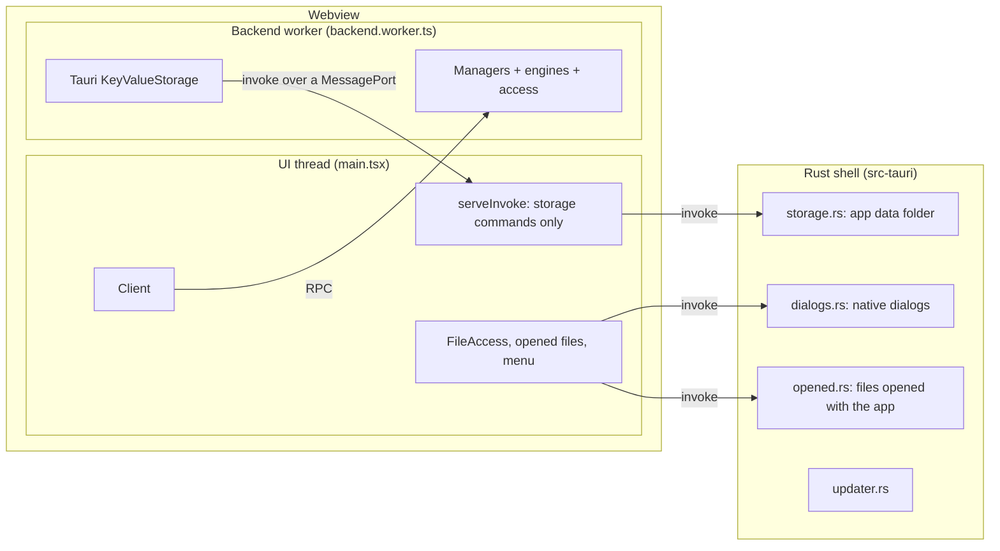

# Desktop

The desktop app is the web app in a Tauri 2 window. It runs the same client, managers and engines; what changes is the platform underneath (storage in the app data folder, native file dialogs) and what only a desktop app can do: open files by double-click, keep one running instance, have a menu bar, update itself, and later serve MCP ([[Architecture/MCP server]]). Tasks: [[CARB-57]] (shell), [[CARB-58]] (releases and updates).

[TOC]

## Layout

```
src/shells/tauri/
├─ index.html, main.tsx      # UI thread: the web app, with the desktop platform wired in
├─ backend.worker.ts         # backend worker entry
├─ backend.ts                # composition root: the managers on desktop storage
├─ opened-files.tsx          # files opened with the app → documents, or the pack trust prompt
├─ menu.ts                   # the macOS menu bar, from the command registry
├─ vite.config.ts            # the web build's config with this entry, into dist/desktop
├─ icon.svg                  # the app icon's source (`pnpm tauri icon …`)
└─ src-tauri/                # the Rust shell: a workspace member (`carbonara-desktop`)
   ├─ tauri.conf.json        # window, CSP, bundles, file associations
   ├─ capabilities/          # what the webview may call
   ├─ linux/                 # the .desktop template and MIME types for the .deb and .rpm
   └─ src/                   # lib.rs (commands, setup), storage.rs, dialogs.rs, opened.rs, updater.rs
src/platforms/tauri/         # the tauri platform: KeyValueStorage, FileAccess, the invoke proxy
```

The Rust shell is a member of the root Cargo workspace but not a *default* member: plain `cargo test` and `cargo clippy` leave it out, because building it needs WebKitGTK on Linux. `-p carbonara-desktop` builds it ([[Development#Desktop]]).

## Threads



Tauri's `invoke` exists only on the UI thread, but the access components that store documents and packs run in the backend worker. So the platform calls are proxied (as [[Architecture#Threads and processes]] says): the UI thread creates a `MessageChannel`, serves the Tauri commands on one end with `serveInvoke`, and posts the other end to the worker as its first message; the worker wraps it in `proxyInvoke` ([[src/platforms/tauri/invoke.ts]]), which has the shape of `invoke`. The UI thread serves only the four storage commands, so code in the worker (which still includes third-party plugins until [[CARB-42]]) can't open dialogs or reach anything else, and the port isn't reachable from the worker's globals.

The composition root [[src/shells/tauri/backend.ts]] is the web one ([[src/shells/web/backend.ts]]) with Tauri storage instead of IndexedDB. Plugins still load from Blob URLs, as in the browser.

## Platform

| Port ([[src/contracts/platform.ts]]) | Desktop implementation | Rust side |
| --- | --- | --- |
| `KeyValueStorage` | [[src/platforms/tauri/key-value.ts]]: JSON text through `storage_keys`, `storage_get`, `storage_set`, `storage_delete` | [[src/shells/tauri/src-tauri/src/storage.rs]] |
| `FileAccess` | [[src/platforms/tauri/files.ts]]: `open_file`, `save_file` | [[src/shells/tauri/src-tauri/src/dialogs.rs]] |
| `ModuleLoader` | The web one (Blob URLs) | — |

- **Storage.** Each storage (`carbonara-documents`, `carbonara-packs`) is a folder in the app data folder (`~/.local/share/io.github.h3ll5ur7er.carbonara/key-value/` on Linux, `%APPDATA%\io.github.h3ll5ur7er.carbonara\key-value\` on Windows, `~/Library/Application Support/io.github.h3ll5ur7er.carbonara/key-value/` on macOS; the webview keeps its own data in `storage/` next to it), with one `<key as hex>.json` file per key. Hex keeps every key a valid, distinct file name on case-insensitive file systems and on Windows (`con`, `nul`). Writes go to a temporary file that is renamed over the old one, so a crash never leaves half a value. The commands run on the async runtime's threads, not the window's. Values are JSON, which is why the `KeyValueStorage` contract says values are JSON values: everything stored (documents, pack info, pack data and plugin source) already is.
- **Files.** The File commands ([[src/client/features/documents/actions.ts]]) pick and save through the `FileAccess` port: the browser's file input and download by default, and native dialogs once the desktop shell calls `setFileAccess`. The dialog runs in Rust and Rust reads or writes the file, so the webview never names a path: it can only reach files the person picked. Bytes cross the bridge as JSON arrays of numbers, which is fine for documents and packs of a few megabytes; switch to Tauri's raw `ipc::Response` if a profile says otherwise.
- **Contract tests.** The TS implementations pass [[src/contracts/platform.contract.ts]] through the real proxy, against the commands faked in memory ([[src/platforms/tauri/fake-storage-commands.ts]]); the Rust store passes the same cases as Rust tests. `pnpm test` and `cargo test -p carbonara-desktop` run them.
- **Drag and drop.** The window's `dragDropEnabled` is off, so dropping a `.cpack` on the window reaches the web app's drop handler as in the browser.

## Opening files

`.carbonara` and `.cpack` are associated with the app (`bundle.fileAssociations`), as `application/x-carbonara` and `application/x-carbonara-pack`. On Linux, Tauri only writes those types into the `.desktop` file, so the `.deb` and `.rpm` also install [[src/shells/tauri/src-tauri/linux/mime.xml]] (which tells the desktop which files have those types) and use their own `.desktop` template ([[src/shells/tauri/src-tauri/linux/carbonara.desktop]]) whose `Exec` passes the file (`%F`). The package managers' triggers register both. An AppImage can't register file types itself; tools such as AppImageLauncher do. Keep the types in the three files the same.

How a file reaches the app depends on the system, and [[src/shells/tauri/src-tauri/src/opened.rs]] hides it:

- **Windows and Linux** start the app with the file's path as an argument.
- **A second launch** (a double-click while the app runs) is caught by the single-instance plugin, which hands its arguments to the running app, brings its window forward, and exits.
- **macOS** sends an `Opened` event to the running app instead of arguments.

The paths wait in a queue until the web app takes them with `take_opened_files`; the shell emits `files-opened` when more arrive. So a file opened at launch isn't lost while the web app is still loading. [[src/shells/tauri/opened-files.tsx]] (rendered after the app, so the File actions are wired up) opens factories as documents (`documentActions.importFile`) and shows packs one at a time in the same trust prompt a dropped pack gets.

## Menus

On macOS the menu bar is built from the command registry ([[src/shells/tauri/menu.ts]]): the app menu (About, Hide, Quit), one menu per registry group with each command's title and shortcut, the native Edit menu (which copy and paste in text fields depend on), and Window. Only shortcuts with `Mod` become native accelerators: plain-key shortcuts (`F` to zoom to fit) would otherwise fire while someone types. Windows and Linux get no native menu bar; the app's own menu behind the wordmark already lists every command, and a second one would repeat it.

## Security

- The webview may call the core APIs (`core:default`: events, menus, windows) and the app's own commands, none of which takes a path ([[src/shells/tauri/src-tauri/capabilities/default.json]]). There's no `fs` or `shell` plugin.
- A Content Security Policy (`tauri.conf.json`, `app.security.csp`) allows only the app's own scripts, Blob URLs (installed packs' plugins) and WebAssembly.
- Storage names are checked in Rust, so a storage can't leave the storage folder.

## Updates and releases

The updater plugin ([[src/shells/tauri/src-tauri/src/updater.rs]]) checks `latest.json` of the latest GitHub release when the app starts and asks before it installs and restarts. Only builds from the release workflow carry the updater's configuration: the workflow writes `tauri.release.conf.json` with the version from the tag, the updater's public key and endpoint, and `createUpdaterArtifacts`. Local and CI builds have no updater and never check.

`.github/workflows/release.yml` runs on tags `v*`: a matrix of Linux (Ubuntu 22.04, for an older glibc), Windows and macOS (universal) builds the installers with `tauri-action` and attaches them, the signed update archives and `latest.json` to a **draft** release. Publishing the draft releases it to installed apps. On Linux only the AppImage updates itself; the `.deb` and `.rpm` update through the package manager.

### Setup the repository owner does once

1. Create the updater's signing key pair on your machine, and choose a password when asked:
   ```bash
   pnpm tauri signer generate -w ~/.tauri/carbonara.key
   ```
   This writes `~/.tauri/carbonara.key` (private) and `~/.tauri/carbonara.key.pub` (public). Never commit either file; keep the private key and its password in your password manager. If the private key is lost, installed apps can't update any more and need a manual reinstall.
2. In GitHub, **Settings → Secrets and variables → Actions**:
   - **Secrets** tab, *New repository secret*: `TAURI_SIGNING_PRIVATE_KEY` with the contents of `~/.tauri/carbonara.key`, and `TAURI_SIGNING_PRIVATE_KEY_PASSWORD` with its password.
   - **Variables** tab, *New repository variable*: `TAURI_UPDATER_PUBKEY` with the contents of `~/.tauri/carbonara.key.pub` (one line).
3. **Settings → Actions → General → Workflow permissions**: the workflow asks for `contents: write` itself; if the organisation restricts that, allow *Read and write permissions*.

### Releasing

1. Tag the commit with a version of three numbers (`v0.2.0`; the Windows installer refuses pre-release suffixes such as `-beta`) and push the tag: `git tag v0.2.0 && git push origin v0.2.0`.
2. Wait for the *Release* workflow; it creates the draft release *Carbonara v0.2.0* with all installers.
3. Check the draft, then **Publish release**. Installed apps offer the update on their next start.

The version in `package.json` stays `0.0.0`: the tag is the release's version.

> [!NOTE]
> The installers aren't code-signed. macOS says the app "can't be opened" until it's allowed in *System Settings → Privacy & Security* (or opened with right-click → *Open*), and Windows SmartScreen asks once. Code signing needs an Apple Developer ID and a Windows certificate; `tauri-action` reads them from the `APPLE_CERTIFICATE`, `APPLE_SIGNING_IDENTITY`, `APPLE_ID`, `APPLE_PASSWORD`, `APPLE_TEAM_ID` secrets (macOS) and `bundle.windows.certificateThumbprint` or a signing command (Windows) once someone sets them up.

## MCP server

The MCP server ([[CARB-60]], `crates/mcp`) starts in the Rust shell's `setup` in [[src/shells/tauri/src-tauri/src/lib.rs]], where a comment marks the place: add the crate as a dependency of `carbonara-desktop` and start it there with the `AppHandle`. The managers live in the webview's backend worker, so a tool call has to reach them through the webview: for example, the shell emits the call as an event, a small listener on the UI thread (next to `OpenedFiles` in [[src/shells/tauri/main.tsx]]) passes it to the connector as an ordinary manager call, and answers through a command. Nothing else in this shell needs to change.

## Building and testing

See [[Development#Desktop]] for the commands. What runs where:

| Check | Where |
| --- | --- |
| TS platform implementations, the proxy, opened files, the menu mapping, the desktop backend | `pnpm test` |
| The Rust store, opened-file handling, updater configuration | `cargo test -p carbonara-desktop` |
| The app builds and bundles on Linux | CI job *Desktop app (Linux)* on every push |
| Installers for all three systems | `release.yml`, on tags |

Dialogs, file associations, the single-instance hand-over, the macOS menu bar and the updater's check need a desktop session to try by hand.

## Known gaps

- **Share links** use the page's address, which is `tauri://localhost` in the desktop app, so a link copied there opens only in the desktop app's own session. They should point at the web app instead.
- **Two composition roots.** [[src/shells/tauri/backend.ts]] repeats the web one with a different storage. When a third appears (or a manager is added), pass the platform into one shared composition root instead.
- **The pack trust prompt for opened files** repeats the packs feature's inspect → prompt → install sequence ([[src/client/features/packs/packs.tsx]]). If the packs feature offered a way to hand it a file, the shell could use that.
