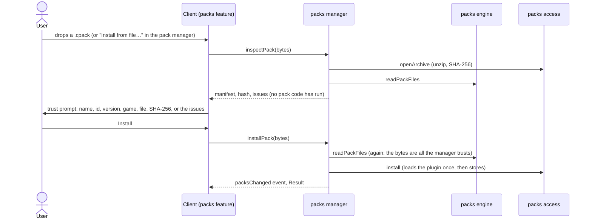

# Game packs

A game pack adds one game to Carbonara. It's a single zip archive with the extension `.cpack`, and it **always** contains both the game's data and its plugin. A document uses exactly one pack.

[TOC]

## Archive layout

```
satisfactory.cpack              # zip archive
├─ manifest.yaml                # identity, versions, entry points
├─ data/                        # JSON or YAML, as many files as you like, merged in order
│  ├─ items.yaml
│  ├─ buildings.yaml
│  ├─ recipes.yaml
│  ├─ logistics.yaml
│  └─ resources.yaml
├─ plugin/
│  └─ index.js                  # bundled ESM: definePlugin({...}), see Plugins
├─ icons/                       # WebP, referenced from data
├─ locales/                     # optional: en.yaml, de.yaml … for names
├─ CREDITS.md                   # asset sources, permissions, attribution
└─ README.md                    # shown in the pack manager
```

## Manifest

```yaml
id: satisfactory
name: Satisfactory
version: 1.2.0                   # pack version (semver)
engine: ^1                       # pack format / plugin API version it targets
game: { name: Satisfactory, version: "1.1" }
data: data/
plugin: plugin/index.js          # required; the template ships a no-op plugin
theme: { accent: "#f5a623" }     # tints the UI
```

## Data

```yaml
units: { rate: per_minute }
items:
  - { id: iron-ore,   name: Iron Ore,   form: solid, icon: icons/iron-ore.webp }
  - { id: iron-ingot, name: Iron Ingot, form: solid }
  - { id: water,      name: Water,      form: fluid }
buildings:
  - id: smelter
    name: Smelter
    speed: 1                           # crafting speed (default 1)
    power: { consume: 4 }              # MW
    fields: { clock: { min: 1, max: 250, default: 100 } }   # interpreted by the plugin
recipes:
  - id: iron-ingot
    buildings: [smelter]               # buildings that can run it; the first is the default
    time: 2                            # seconds per craft
    in:  { iron-ore: 1 }
    out: { iron-ingot: 1 }
  - id: alt-pure-iron-ingot
    buildings: [refinery]
    time: 12
    in:  { iron-ore: 7, water: 4 }
    out: { iron-ingot: 13 }
    tags: [alternate]
logistics:
  - { id: belt-mk1, name: Conveyor Belt Mk.1, aliases: [mk1 belt], carries: solid, capacity: 60 }
  - { id: pipe-mk1, carries: fluid, capacity: 300 }
resources:
  - { item: iron-ore, limit: 92100, extractors: [miner-mk1, miner-mk2] }   # limit: the most the map yields
```

`aliases` let plain language ("yellow belt") resolve to data, for the MCP tools and the command palette.

Item ids may carry a variant after `@` (`steam@500`, `gear@rare`), for plugins that model temperatures or quality. Probabilistic outputs are written as expected values (`0.25`).

The zod schemas in [[src/contracts/pack.ts]] are the source of truth for the shape. `pnpm schema` generates JSON Schemas for pack authors and editors into `schemas/`, and a test fails when they're out of date. Rules beyond the shape (every reference resolves, no id defined twice) are the `packs` engine's: [[src/engines/packs/references.ts]].

## Reading a pack

Whether it comes from a `.cpack` or an unpacked folder, a pack is a set of files, and one pure function decides whether they make a valid pack: `readPackFiles` in [[src/engines/packs/files.ts]]. It parses `manifest.yaml`, checks the `engine` range, checks the plugin file exists, merges the files in `data/` in name order (arrays are concatenated; `units` may be defined in only one file; unknown top-level sections are refused), validates the result and checks every reference.

Problems come back as issues whose path starts with the file name and that carry the YAML line and column ([[src/engines/packs/source.ts]] keeps each file's parsed document and `LineCounter`; JSON files go through the same parser). A map entry is located at its key; a missing field at the closest node that exists; a reference problem in the merged data (`recipes[12].in.coal`) at the file and entry it came from. `describeIssue` ([[src/utilities/issues.ts]]) writes an issue the way the app and the CLI show it:

```
data/recipes.yaml:7:11: recipes[0].in.coal: Unknown item 'coal'
manifest.yaml:4:1: engine: Needs pack format ^2, but this version of Carbonara reads pack format 1.0.0
```

**Pack format.** `PACK_FORMAT` in [[src/engines/packs/format.ts]] is the pack format and plugin API version this build implements (now `1.0.0`). A manifest's `engine` range (`^1`, `~1.2`, `1.2.3`, npm semantics) must include it, or the pack is refused before its data is read. Bump the minor version for additive changes and the major for breaking ones. The broken fixture packs in [[src/engines/packs/broken-packs.test.ts]] pin the message for each kind of mistake; add one when you add a rule.

## Built-in and third-party packs

- **Built-in packs:** the app ships every pack we maintain (`packs/satisfactory`, `packs/factorio`, …). They're built at app build time, preinstalled and trusted, and they update with the app. They can also be updated on their own, without an app release.
- **Third-party packs:** drop a `.cpack` on the app, open it with a file dialog, or double-click it on desktop. The `packs` manager reads it, the `packs` engine validates the manifest and data and checks the `engine` range, and errors name the file plus the YAML line and column. Because a pack contains code, installing one shows a trust prompt with its id, version and hash ([[Architecture/Plugins]]). Installed packs are stored in IndexedDB (web) or the app data folder (desktop).
- **Identity:** a pack is content-addressed (a hash of the whole archive). Documents record pack id, version and hash. When a document's pack is missing or has a different version, opening it offers to install or migrate.

### Where packs live

The `packs` access component ([[src/access/packs/library.ts]]) implements the `PackStore` from [[src/contracts/access.ts]] plus `install` and `remove`. It hides three things:

- **The archive format** ([[src/access/packs/archive.ts]]): a `.cpack` is a zip, opened with fflate in the backend worker so it never blocks the UI. Its identity is the hex SHA-256 of the archive bytes. Pack builds are reproducible (sorted entries, a fixed zip timestamp), so building the same folder twice gives the same hash.
- **Built-in packs:** the Vite plugin in [[tools/pack-cli/vite-plugin.ts]] builds every folder in `packs/` that has a `manifest.yaml` with the same code as `carbonara-pack build` ([[tools/pack-cli/built-in-packs.ts]]), and serves them as the virtual module `virtual:built-in-packs`: a list of `{ info, load }`, where `load` imports the pack's data and plugin as separate chunks on first use. Built-in plugins are bundled into the backend worker like any other module. A broken pack fails the app build with the CLI's messages. Production builds ship the game packs (Satisfactory and Factorio); the **template pack is built in only by the dev server** (and so in e2e tests and Vitest), so there's always a small pack to try things with. While `pnpm dev` runs, editing a file in `packs/` rebuilds the packs and reloads the app. The packs are built in a `tsx` child process, so the app's TypeScript modules stay out of the Vite config's module graph (Vite's config loader can't follow their extensionless imports natively); that's why the configs import `vite-plugin.ts` with its extension.
- **Installed packs** are kept in the `KeyValueStorage` port ([[src/contracts/platform.ts]]) that documents use too: IndexedDB (database `carbonara-packs`) on the web, memory in tests ([[src/utilities/memory-key-value.ts]]). Each pack has two keys: `info/<id>` holds its `PackInfo`, so listing reads no pack data, and `contents/<id>` its validated data and its plugin's source. The info is written last and removed first, so a pack counts as installed only while it's complete. Loading an installed pack needs no unzipping or validating again. Plugins load through the `ModuleLoader` port: a Blob URL `import()` in the backend worker ([[src/platforms/web/module-loader.ts]]), a data URL in Node. Installing loads the plugin once and refuses a pack whose plugin doesn't load or doesn't `export default` a plugin with an `id`.

An installed pack with the id of a built-in pack stands in for it until it's removed; that's how a built-in pack updates without an app release. Installing a pack whose id is already installed replaces it.

Why not OPFS: a pack's data and plugin are structured-cloneable values of a few megabytes, which IndexedDB stores well, and one storage port with one contract suite ([[src/contracts/platform.contract.ts]], run against memory and IndexedDB) is simpler than two. OPFS pays off for streaming large binary files; reconsider it if packs start keeping icons or other assets in bulk.

> [!WARNING]
> Third-party plugins currently run in the backend worker like built-in ones. Moving them to an opaque-origin plugin worker is [[CARB-42]].

### Installing a pack

The `packs` manager ([[src/managers/packs.ts]]) sequences it; the client's pack feature ([[src/client/features/packs/packs.tsx]]) is the UI.



- The top bar's **Game packs** button opens the pack manager: every pack with its version, id and the start of its hash; built-in packs are marked, installed ones can be removed. Dropping a `.cpack` anywhere on the app, or picking one, opens the trust prompt. Its dialogs are native `<dialog>` elements until the design system has its dialog primitive ([[CARB-21]]).
- `getPackData` and `removePack` throw for packs that don't exist or aren't installed: a client only asks for packs it was told about.

## Authoring

- `carbonara-pack new <id> [--into packs] [--name <name>]` scaffolds a pack from `packs/_template` (*Template Works*), a small original example game with a no-op plugin. It sets the id, name and version `0.1.0`, writes a fresh README, CREDITS and plugin, and points the plugin's import of `definePlugin` at this repository wherever the new folder is. The template is the starting point for authors and a test fixture; production builds of the app don't list it.
- `carbonara-pack validate <folder>` lists every problem as `file:line:column: path: message`, `build <folder> [--out dist/packs]` bundles the plugin with esbuild and zips a reproducible `.cpack` (printing its SHA-256), and `dev <folder>` builds, then rebuilds on every change. Packs inside this repository's `packs/` also reload in a running `pnpm dev`; loading a pack folder from elsewhere into the running app (File System Access API on the web, a folder watch on desktop) is [[CARB-72]].
- `carbonara-pack import <pack> <file>… [--icons <folder>]…` ([[tools/pack-cli/import.ts]]) runs the pack plugin's importer to regenerate `data/` and `icons/` from the game's own data files (Satisfactory's `Docs.json`, Factorio's `--dump-data` output) when a game updates, turns icon images into 64×64 WebP (the left square of an image wider than tall, Factorio's mipmap strips), writes one Prettier-clean YAML file per section, and then validates the pack. `<pack>` is a folder or the id of a pack in `packs/`. The importer's `accepts` lists the file names it reads.
- The CLI ([[tools/pack-cli/main.ts]]; `pnpm carbonara-pack …`, with `pnpm pack:build` and `pnpm pack:import` as shorthands) calls the packs engine directly rather than the packs manager. Going through the manager would mean zipping a folder only to unzip it again and wiring a backend with stand-in storage to call one pure function; no CLI command needs installed packs. Revisit when one does (installing into the desktop app's pack folder, say).
- The MCP server exposes the same steps as tools for AI-assisted authoring ([[Architecture/MCP server]]).

## Satisfactory pack

`packs/satisfactory` holds Satisfactory 1.1. Its `data/` and `icons/` are generated by the plugin's importer from the game's `CommunityResources/Docs/en-US.json` (`Docs.json` before 1.1). `pnpm pack:import satisfactory <file> --icons <folder>` (that is, `carbonara-pack import`) regenerates them. The pack's `README.md` says how to update it, and `CREDITS.md` names every source.

Conventions the importer follows ([[packs/satisfactory/plugin/importer.ts]]):

- Ids are the game's display names in kebab case (`iron-ingot`, `miner-mk1`); alternates are `alt-…` and tagged `alternate`. Fluids are in m³, rates per minute.
- Recipes are what machines run; build-gun and workbench recipes are left out, and so are items no machine, generator or resource node deals with (equipment, consumables).
- Each generator fuel becomes a recipe tagged `power` that burns one unit at full power, so fuel, water and nuclear waste flow through the graph.
- Machines whose power depends on the recipe (Particle Accelerator, Converter, Quantum Encoder) get the middle of their range for now. Every building has `fields.clock`; the mechanics are [[CARB-43]].
- The map's resource limits aren't in the game's data, so the importer keeps them in a table.

## Factorio pack

`packs/factorio` holds Factorio 2.1 with Space Age ([[CARB-30]]). Its `data/` and `icons/` are generated by the plugin's importer from the game's `factorio --dump-data` output (`script-output/data-raw-dump.json`) and, optionally, its English locale files (`base.cfg`, `space-age.cfg` …; without them names come from the ids). The pack's `README.md` says how to update it and what the data leaves out, and `CREDITS.md` names every source.

Conventions the importer follows ([[packs/factorio/plugin/importer.ts]]):

- Ids are the game's prototype names; rates are per second. A recipe lists every crafting machine whose crafting categories include one of its own (2.1 gives recipes several categories, 2.0 one), base game machines first and slower before faster, so the first is the early-game default.
- Probabilistic results are expected values (`probability`, `independent_probability`, `shared_probability`, `extra_count_fraction`, `amount_min`/`amount_max`). Catalysts stay on both sides (Kovarex: 40 U-235 in, 41 out).
- Recycling recipes are in, tagged `recycling`; other hidden recipes, blueprint parameters and recipes of hidden or spawnable items (the editor's infinity chest, blueprints) are out.
- **Expansion content:** each recipe is tagged with the expansion mods it needs (`space-age`, `quality`, `recycler`, `elevated-rails`), judged by the mod its icon and items come from, and by its machines when no base machine runs it. Buildings from an expansion mod have `fields.mod.name`. The dump doesn't record which mod defined a prototype, so the icon path (`__space-age__/…`) decides. A later plugin filters on these with `recipeAvailable`.
- Buildings keep what the mechanics plugin ([[CARB-44]]) needs in `fields`: `modules` (slots and accepted effects), `base-effect` (the foundry's +50% productivity) and `energy` for fuel-burning buildings. `power.consume` is MW at full speed with the electric drain (1/30 for crafting machines).
- Resources are infinite in Factorio, so they have no `limit`; their extractors are the mining drills of the patch's resource category, offshore pumps for tile fluids (water, lava …), agricultural towers for plants and asteroid collectors for asteroid chunks.
- Belt throughput is `speed × 8 items per tile × 60 ticks` (yellow 15/s to turbo 60/s), with colour aliases kept in a table; pipe throughput (6000/s) isn't in the data, so it's a constant.
- Icons are matched by prototype name, then by the dump's icon file name. Factorio's own icons are strips of mipmaps; `pack:import` takes an image wider than tall to be one and uses its left square.

## Assets and permissions

Every pack bundles its full data and icons; there are no install-path lookups at runtime. Before we publish a build that includes a game's pack, we get the publisher's OK or confirm their fan-content policy covers it, and record the result in the pack's `CREDITS.md`. Each pack is a separate unit, so a takedown request affects only that game's pack.

## Scope

v1 supports one pack per document. Mod packs that extend a base pack (`extends: factorio`) are a later addition, and the manifest leaves room for it.
