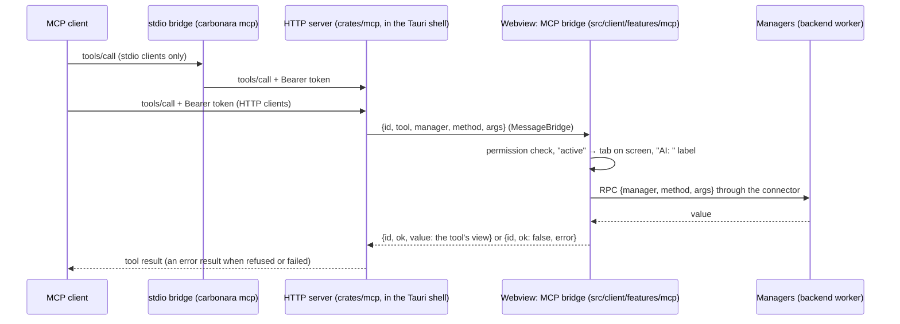

# MCP server

The desktop app runs an MCP server, so any MCP client (Claude Desktop, Claude Code and others) can read and edit your factories and help you build packs. The aim is that "create a steel smelting setup that produces 2 full yellow belts" just works.

The MCP server is a **client** in the [[Architecture]] sense: it calls the same managers the UI calls, and nothing else.

[TOC]

## How it's built

- The server is the crate [[crates/mcp]] (Rust, `rmcp` 3.8), which the Tauri shell runs. It serves Streamable HTTP on `127.0.0.1` with a per-install token. `carbonara mcp` is a stdio bridge in the same binary for clients that only launch stdio servers. A settings panel offers one-click "copy config" snippets for common clients.
- Each tool call is forwarded to the client's connector and from there, as an ordinary RPC call, to the managers in the backend worker. If the app isn't running, tools return a clear error.



### The crate

| Piece | What it does |
| --- | --- |
| `Manifest` | The tools, resources and prompts of [[crates/mcp/manifest.json]], embedded at build time |
| `CarbonaraServer<B: Bridge>` | The MCP handler: lists tools, resources and prompts; forwards tool calls and tool-backed resources through the bridge. Failures come back as tool results with `isError`, so the model reads why |
| `Bridge`, `BridgeCall` | `call({tool, manager, method, args}) → Result<Value, BridgeError>`; `Unavailable` when nothing answers, `Failed` when the app refused or a manager failed |
| `MessageBridge` | A `Bridge` over a message pipe: sends `{id, tool, manager, method, args}` and resolves the call when `answer({id, ok, value \| error})` arrives; gives up after 120 s |
| `serve_http` | Binds `127.0.0.1:<port>` (0 = any free port) and serves `/mcp`. Requests need `Authorization: Bearer <token>` (401 otherwise); the `Host` must be loopback (no DNS rebinding) and a request with an `Origin` header is refused (no web pages) |
| `Token` | 256 random bits, created once per install and stored readable by the user only |
| `Connection` | `{url, token}` in a file the app writes when the server starts, so the stdio bridge finds it |
| `run_stdio` | The stdio bridge: an MCP server on stdin/stdout that forwards every request to the HTTP server named in the connection file, connecting lazily and again after the app restarts. `carbonara-mcp-stdio <connection file>` runs it alone, for development and tests |

### Plugging it into the desktop shell

The desktop shell (`src/shells/tauri/`) wires both ends. In Rust, at startup:

```rust
let config = app.path().app_config_dir()?;
let token = carbonara_mcp::Token::load_or_create(&config.join("mcp-token"))?;
let bridge = Arc::new(carbonara_mcp::MessageBridge::new({
    let app = app.handle().clone();
    move |call| app.emit("mcp-call", call).map_err(|error| error.to_string())
}));
let manifest = Arc::new(carbonara_mcp::Manifest::bundled()?);
let server = carbonara_mcp::serve_http(manifest, bridge.clone(), 41736, token.clone()).await?;
carbonara_mcp::Connection { url: server.url(), token: token.as_str().into() }
    .write(&config.join("mcp.json"))?;
// A command the webview calls with each answer:
#[tauri::command] fn mcp_answer(bridge: State<Arc<MessageBridge>>, answer: serde_json::Value) { bridge.answer(answer); }
```

`carbonara mcp` (the subcommand) calls `carbonara_mcp::run_stdio(config.join("mcp.json"))` and nothing else: it must not open a window.

In the webview, once, after creating the connector and before rendering:

```ts
attachMcpShell({
  connector,
  transport: {
    send: (answer) => void invoke("mcp_answer", { answer }),
    listen: (listener) => void listen("mcp-call", (event) => listener(event.payload)),
  },
});
```

`attachMcpShell` ([[src/client/features/mcp/host.tsx]]) starts the bridge ([[src/client/features/mcp/bridge.ts]]); `McpHost`, which the live app renders, tells it which tab is on screen. The web app never calls it, so it has no MCP.
- **Tools are generated from the manager contracts** (DRY): each MCP-exposed manager method carries a description, its zod schema becomes the tool's input schema, and it belongs to a permission group.
- **Edits go through the normal command pipeline:** each tool call becomes one undo step, labelled "AI: …" in the history panel.
- **Proposals instead of surprises:** generative tools don't change the document directly by default. They create a proposal, shown as a ghost overlay with a summary card (machines, raw inputs, power) and *Accept*, *Adjust* and *Discard* buttons. A setting allows edits to be applied directly instead.
- **Permissions:** read-only by default. The *Edit* and *Pack authoring* groups are switched on separately in settings. An activity panel lists every call.

## Tools

A tool is a manager method with `mcp` metadata in [[src/contracts/managers.ts]]: its tool name, permission group, description and, optionally, a **view**. `pnpm mcp:tools` ([[tools/mcp-tools.ts]]) turns every such method into an entry of [[crates/mcp/manifest.json]], with the JSON Schema of the method's zod arguments as the tool's input schema, and the Rust server embeds that file. A new manager method becomes a tool by adding the metadata and running `pnpm mcp:tools`; `pnpm check` fails while the committed manifest is out of date.

A view ([[src/client/features/mcp/views.ts]]) is the part of the method's value the tool answers with, so one method can back several focused tools and large answers stay small enough for a model: `get_totals` and `get_diagnostics` both call `analysis.getResults`. Every tool that takes a `documentId` also accepts `"active"`, the document on screen.

| Group | Tool | Calls | |
| --- | --- | --- | --- |
| Read | `list_documents` | `workspace.listDocuments` | |
| Read | `get_graph` | `editing.getDocument`, view `graph` | Every node, edge and position; graphs over 200 nodes come back as counts per kind, recipe and item |
| Read | `get_totals` | `analysis.getResults`, view `totals` | Raw inputs and buildings |
| Read | `get_diagnostics` | `analysis.getResults`, view `diagnostics` | Deficits, surpluses, overflows, missed pins, errors |
| Read | `list_packs` | `packs.listPacks` | |
| Read | `get_pack_data` | `packs.getPackData` | Items, recipes, buildings, logistics, resources: the ids `edit_graph` needs |
| Edit | `edit_graph` | `editing.apply` | Any batch of [[src/contracts/commands.ts]] commands, as one undo step |
| Edit | `undo` | `editing.undo` | |

Still to come, each with the manager method it needs: `search_catalog` and `get_recipe` (a catalog query on the packs manager, for packs too large for `get_pack_data`), `explain_node` (analysis), `convert_rate`, `plan_production` and `compare_recipes` (planning, [[CARB-45]]), `apply_proposal` ([[CARB-46]]), `auto_arrange` ([[CARB-49]]), `replace_recipe` ([[CARB-53]]), `create_subgraph` ([[CARB-39]]), and the pack authoring tools `scaffold_pack`, `read_pack_file` / `write_pack_file` (only inside a dev pack folder), `validate_pack`, `reload_dev_pack` and `build_cpack` ([[CARB-72]]). `get_pack_schema` and `get_plugin_api_docs` became resources.

**One edit tool, not one per command.** `edit_graph` takes any batch of commands rather than separate `add_nodes`, `connect` and `set_node_fields` tools: the command union is the single source of truth for edits, so new commands reach MCP clients without touching the generator; a production line (nodes plus the edges between them) stays one undo step, as each tool call should be; and the JSON Schema of the union documents every command for the model. The cost is one large input schema.

**Resources** (in the manifest): the JSON Schemas of pack manifests, pack data and documents; the plugin API (the text of [[src/contracts/plugin.ts]]); and `carbonara://documents/active`, which the server answers by calling `get_graph` for the active document. **Prompts:** `design_production_line(item, rate)` and `create_pack(game)`.

## Example

"Steel, 2 full yellow belts":

1. `convert_rate` finds that a yellow belt carries 15/s in the Factorio pack, so the target is 30/s = 1800 steel/min.
2. `plan_production({ steel-plate: 1800/min })` creates a ghost proposal next to the existing factory: 480 steel furnaces (240 smelting iron plate, 240 making steel) and 9000 iron ore/min.
3. You click *Accept*, and `auto_arrange` tidies it up.

## Security

- Bound to `127.0.0.1` only, with a per-install token.
- Read-only by default; edit and authoring tools need separate opt-in.
- File writes are limited to dev pack folders.
- Every call is logged and every edit is undoable.

## Web version

Browsers can't host an MCP server, so the web app has no MCP in v1. A companion relay is a possible later addition.
