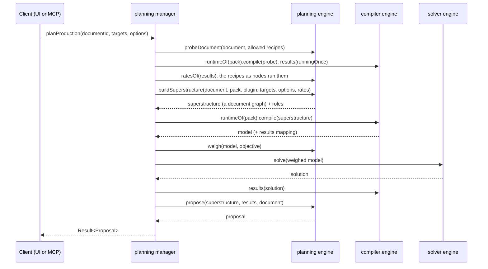

# Planning

The `planning` engine and manager turn goals ("1 iron plate a second") into a proposed factory: the recipes, raw inputs, outputs and flows that make the goals with as little as possible, laid out beside the existing factory. The UI shows the proposal as a ghost to accept, adjust or discard ([[Design]], Goal planner); MCP clients get it from `plan_production` ([[Architecture/MCP server]]).

What the engine hides: which recipes a plan considers, what makes one plan better than another, and how a solved plan is shaped into nodes, flows and positions. It never solves anything itself: the compiler and the solver do that, sequenced by the manager.

[TOC]

## The use case

[[src/contracts/managers.ts]] declares both methods (`planning.planProduction`, `planning.compareRecipes`) with their MCP tools, `plan_production` and `compare_recipes` in the *Plan* group. Rates are in items per second, like everywhere behind the managers; the UI converts from the document's unit.

## Superstructure

`buildSuperstructure` ([[src/engines/planning/superstructure.ts]]) builds every way the pack could make the targets as an ordinary document graph, so the compiler (and the pack's plugin hooks) treat it exactly like a document:

- **Candidates:** walk upstream from the target items: every allowed recipe that makes an item (more out than in), then the items it uses. Downstream recipes (motor recycling for a motor goal) are left out unless they also make something needed.
- **Recipes as nodes run them:** a pack's plugin may change what a recipe takes and makes (Factorio adds the fuel a stone furnace burns and the cells a reactor burns out, [[CARB-77]]). So before the walk the manager compiles a *probe* ([[src/engines/planning/probe.ts]]): one node per allowed recipe, default fields, nothing connected; it maps "every node runs once" back through the runtime's results and passes the rates per recipe to `buildSuperstructure` (`rates`). The walk, the hubs' edges and the spills follow those rates, the pack's recipe order first. It costs one more compile per request (`compareRecipes` probes once for all its rivals), and works for isolated plugins too.
- **Allowed:** not in `options.exclude`, not tagged `alternate` when `options.alternates` is off, and `recipeAvailable` from the pack's plugin (with the document's plugin settings) doesn't say no.
- **Hubs:** one junction per item joins all of its producers to all of its consumers, so the solver chooses the mix. Cycles such as the template's water loop need nothing special.
- **Raw inputs:** a source for each item in the pack's `resources` (capped at its map `limit`) and for each needed item nothing allowed makes. When comparing recipes, the target item gets no source, so the recipe compared really makes it.
- **Targets:** one pinned sink per item, rates added up.
- **Spills:** every item a candidate makes also flows into a free, unpinned sink. Without them the solver's last tier (fewer unused outputs) would convert spare byproducts into other items within the cost tier's tolerance (seen as 2·10⁻⁵ of a coal furnace burning sludge). With them, byproducts are explicit flows.

## Objective

`weigh` ([[src/engines/planning/objective.ts]]) sets the model's costs. The solver meets pins and avoids deficits first ([[Architecture/Solver]], Objective tiers), then minimises cost:

| `options.objective` | Raw input, per item/s | Machine |
| --- | --- | --- |
| `resources` (default) | 1 | 0.001 |
| `buildings` | 0.001 | 1 |

The small weight breaks ties and keeps zero-cost loops from running. Machines are priced per machine (fractional), in the recipe's default building.

The manager compiles through the pack's plugin runtime (`runtimeOf`), so third-party packs compile in their sandbox, and the compiled model doesn't name its nodes. `weigh` tells them apart by the compiler's conventions ([[Architecture/Solver]], From documents to the IR): a raw source costs 1, a sink has a single negative rate, junctions are junctions, and everything else is a machine. An isolated plugin can't be asked `recipeAvailable` from the manager, so for third-party packs every recipe is a candidate (the compiled plan then carries the compiler's "isn't unlocked" warnings).

## Proposal

`propose` ([[src/engines/planning/proposal.ts]]) reads the solve in superstructure ids and builds the `Proposal`:

- **Nodes:** recipes and raw sources that run, the target outputs, and one output per byproduct. Ids are readable and free in the document: the recipe id (`iron-plate`), `source-<item>`, `output-<item>`, `byproduct-<item>`, with `-2`, `-3` … when taken. Accepting the same proposal twice fails instead of duplicating it.
- **Flows:** the hubs dissolve. Each hub's producers are matched to its consumers in order (users, then the target, then the spill) by the north-west corner rule, so a hub with *p* producers and *c* consumers becomes at most *p + c − 1* direct edges.
- **Layout** ([[src/engines/planning/layout.ts]]): layered, left to right. A depth-first walk from the raw inputs drops the edges that close cycles; every node goes one column right of its furthest input; raw inputs take the first column and targets the last; columns are ordered by the barycentre of their neighbours; nodes line up with what feeds them (raw inputs with what they feed) and land on the grid. Node sizes approximate the canvas geometry, which the engines can't import. It's a stand-in until the `layout` engine ([[CARB-49]]); auto-arrange tidies up further.
- **Placement:** right of the document's factory with an 8-grid gap, level with its top; at the origin in an empty document.
- **Commands:** `addNode` for each node, then `connect` for each flow, for one `editing.apply` batch (one undo step).
- **Preview results** under the commands' ids (machine counts, rates, flows) for the ghost, and a **summary**: buildings (rounded up per node), raw inputs, byproducts, shortfalls (deficits, e.g. when a raw input hits its map limit) and power (the plugin's derived `power`, Satisfactory's metric in MW, or `powerMW`; else the building's `power.consume` × machines).

Accepting a proposal gives a document whose own solve has no deficits and the same raw use (tested for every item the template pack makes, in [[src/managers/planning.test.ts]]).

## Comparing recipes

`compareRecipes(item, perSecond)` plans the item once per allowed recipe that makes it, with that recipe forced (`via`), and ranks the summaries ([[src/engines/planning/compare.ts]]): least shortfall first, then the objective's measure (total raw rate or total buildings), then the other.

## Limits and next steps

- Recipes run in their default building; choosing buildings (a faster assembler) would be one candidate per recipe and building.
- Flows get no belt or pipe; the plan's flows are as wide as they need to be.
- The plan doesn't use what the existing factory already makes; it's planned on its own.
- Raw inputs all weigh the same per item/s. With Factorio's Space Age data, "fewest raw items" for steel prefers asteroid crushing and foundry casting (3.2 chunks/s) over 150 iron ore/s; excluding the foundry, crusher, electromagnetic plant and recycler recipes gives the ore plan (960 stone furnaces, the default building). Per-resource weights or a plugin `recipeAvailable` tied to a save profile would make this choice explicit.
- Planning the whole Factorio pack takes about 2 s (the superstructure reaches much of the pack through asteroid recipes); about 20 ms with Space Age excluded, plus the probe (about 60 ms for Factorio's recipes). 10 iron plates/s without Space Age: 32 stone furnaces burning 0.72 coal/s; 100 MW of `electricity`: nuclear reactors, heat exchangers and steam turbines.
- An item nothing allowed makes is a raw input, whatever it is: with the reactors and heating towers excluded, Factorio's `heat` becomes one, and at a cost of 1 per MW it undercuts a boiler's coal and water.
