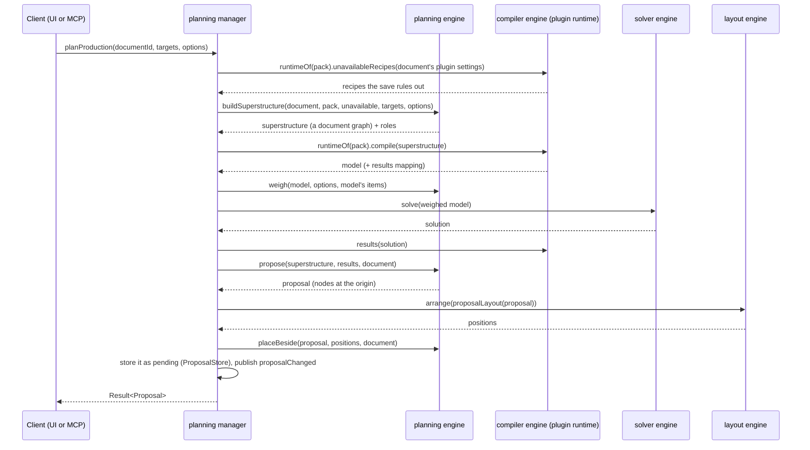
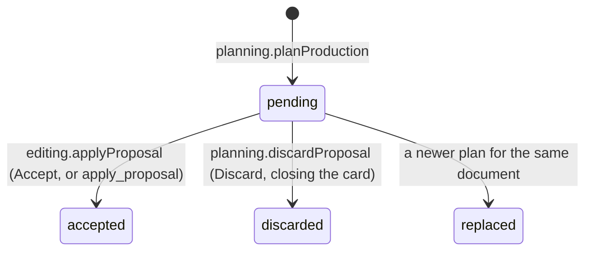

# Planning

The `planning` engine and manager turn goals ("1 iron plate a second") into a proposed factory: the recipes, raw inputs, outputs and flows that make the goals with as little as possible, laid out beside the existing factory. The UI shows the proposal as a ghost to accept, adjust or discard ([[Design]], Goal planner); MCP clients get it from `plan_production` ([[Architecture/MCP server]]).

What the engine hides: which recipes a plan considers, what makes one plan better than another, and how a solved plan is shaped into nodes, flows and positions. It never solves anything itself: the compiler and the solver do that, sequenced by the manager.

[TOC]

## The use case

[[src/contracts/managers.ts]] declares the methods (`planning.planProduction`, `compareRecipes`, `discardProposal`, `convertRate`, and `editing.applyProposal`) with their MCP tools: `plan_production` and `compare_recipes` in the *Plan* group, `convert_rate` in *Read*, `apply_proposal` in *Edit*. Rates are in items per second, like everywhere behind the managers; the UI converts from the document's unit, and `convertRate` from what people say ("2 full yellow belts": the pack's logistics by id, name or alias, at full capacity; or `per_minute`, `/h` …) into items per second ([[src/engines/planning/rates.ts]]).

## Proposals

Every proposal `planProduction` makes is kept in the `ProposalStore` (proposals access, [[src/access/proposals/memory.ts]], in memory for the session) under an id a model can read back (`proposal-1`, `proposal-2` …), and goes through these states, each published as `proposalChanged { proposal, status }`:

- **Who owns what:** the planning manager makes, replaces and discards proposals; the editing manager accepts them, because adding the commands and the undo step is its use case. The store is the access component they share (like the `DocumentStore`), so neither calls the other, and the event tells everyone else.
- **One pending proposal per document:** a new plan replaces the document's pending one. Comparing recipes plans too, but keeps nothing.
- **Accepting** applies the commands, moved by the ghost's `offset`, as one `editing.apply`-style batch with the caller's label, then settles the proposal. A proposal that isn't pending fails with why, in words for a model: accepted already, discarded by the person ("ask them what to change, then plan again"), or replaced. Commands that no longer fit the document (an id taken since) fail and leave it pending.
- **The UI follows the events** ([[src/client/features/planner/planner-store.ts]] `followProposals`, started by the live app): a pending proposal opens the planner card on its document's tab, whoever made it; the shown one moves to *Accepted* or leaves when it's settled. So a proposal from an MCP client looks exactly like the person's own ([[Design]], Goal planner).
- Closing a document drops its proposals; a restart starts without any.

## Superstructure

`buildSuperstructure` ([[src/engines/planning/superstructure.ts]]) builds every way the pack could make the targets as an ordinary document graph, so the compiler (and the pack's plugin hooks) treat it exactly like a document:

- **Candidates:** walk upstream from the target items: every allowed recipe that makes an item (more out than in), then the items it uses. Downstream recipes (motor recycling for a motor goal) are left out unless they also make something needed.
- **Allowed:** not in `options.exclude`, not tagged `alternate` when `options.alternates` is off, and not ruled out by the pack plugin's `recipeAvailable` under the document's save profile. The manager asks the plugin runtime (`unavailableRecipes`), so the settings' defaults are filled in (a document without a profile plans like one at the defaults), and third-party packs are asked in their sandbox like built-in ones.
- **Buildings:** each recipe runs in the first of `options.buildings` it allows (`steel-furnace`, `assembling-machine-3` …), else in its default building (the first of its `buildings`). One preference list covers every building family: a family is the set of buildings that recipes offer in place of one default building. The planner card shows one choice per family ([[Design]], Goal planner); MCP clients pass the ids.
- **Hubs:** one junction per item joins all of its producers to all of its consumers, so the solver chooses the mix. Cycles such as the template's water loop need nothing special.
- **Raw inputs:** a source for each item in the pack's `resources` (capped at its map `limit`) and for each needed item nothing allowed makes. When comparing recipes, the target item gets no source, so the recipe compared really makes it.
- **Targets:** one pinned sink per item, rates added up.
- **Spills:** every item a candidate makes also flows into a free, unpinned sink. Without them the solver's last tier (fewer unused outputs) would convert spare byproducts into other items within the cost tier's tolerance (seen as 2·10⁻⁵ of a coal furnace burning sludge). With them, byproducts are explicit flows.

## Objective

`weigh` ([[src/engines/planning/objective.ts]]) sets the model's costs. The solver meets pins and avoids deficits first ([[Architecture/Solver]], Objective tiers), then minimises cost:

| `options.objective` | Raw input, per item/s | Machine |
| --- | --- | --- |
| `resources` (default) | 1 × the resource's weight | 0.001 |
| `buildings` | 0.001 × the resource's weight | 1 |

The small weight breaks ties and keeps zero-cost loops from running. Machines are priced per machine (fractional), in the building the recipe runs in. `options.resourceWeights` weighs raw resources against each other (1 when not named): with the template pack, water at 100 makes iron plates from ore and coal instead of washing ferrite. The compiled model names its items by index (`CompiledModel.items`), which is how `weigh` finds each raw source's item.

The manager compiles through the pack's plugin runtime (`runtimeOf`), so third-party packs compile in their sandbox, and the compiled model doesn't name its nodes. `weigh` tells them apart by the compiler's conventions ([[Architecture/Solver]], From documents to the IR): a raw source costs 1, a sink has a single negative rate, junctions are junctions, and everything else is a machine. An isolated plugin can't be asked `recipeAvailable` from the manager, so for third-party packs every recipe is a candidate (the compiled plan then carries the compiler's "isn't unlocked" warnings).

## Proposal

`propose` ([[src/engines/planning/proposal.ts]]) reads the solve in superstructure ids and builds the `Proposal`:

- **Nodes:** recipes and raw sources that run, the target outputs, and one output per byproduct. Ids are readable and free in the document: the recipe id (`iron-plate`), `source-<item>`, `output-<item>`, `byproduct-<item>`, with `-2`, `-3` … when taken. Accepting the same proposal twice fails instead of duplicating it.
- **Flows:** the hubs dissolve. Each hub's producers are matched to its consumers in order (users, then the target, then the spill) by the north-west corner rule, so a hub with *p* producers and *c* consumers becomes at most *p + c − 1* direct edges.
- **Belts and pipes:** each flow goes on the smallest logistics of its item's form (solid or fluid) whose capacity carries it alone, so the accepted factory reads like a built one (and its belts show their load). A flow no single belt or pipe carries stays without one.
- **Layout:** the layout engine's `arrange` (ELK, layered, left to right, [[CARB-49]]), the same as auto-arrange, with node shapes from `proposalLayout`: sizes and port positions that approximate the canvas geometry, which the engines can't import. Raw inputs take the first layer.
- **Placement** (`placeBeside`): the laid-out block right of the document's factory with an 8-grid gap, level with its top; at the origin in an empty document.
- **Commands:** `addNode` for each node, then `connect` for each flow, for one batch (one undo step) when accepted.
- **Preview results** under the commands' ids (machine counts, rates, flows) for the ghost, and a **summary**: buildings (rounded up per node), raw inputs, byproducts, shortfalls (deficits, e.g. when a raw input hits its map limit) and power (the plugin's derived `power`, Satisfactory's metric in MW, or `powerMW`; else the building's `power.consume` × machines).

Accepting a proposal gives a document whose own solve has no deficits and the same raw use (tested for every item the template pack makes, in [[src/managers/planning.test.ts]]).

## Comparing recipes

`compareRecipes(item, perSecond)` plans the item once per allowed recipe that makes it, with that recipe forced (`via`), and ranks the summaries ([[src/engines/planning/compare.ts]]): least shortfall first, then the objective's measure (total raw rate or total buildings), then the other.

## Limits and next steps

- The building preference is the person's (or the model's) choice; the planner doesn't pick the fastest building on its own, since that depends on what the save has.
- A flow wider than the largest belt gets none; splitting it over parallel belts is left to the person.
- The plan doesn't use what the existing factory already makes; it's planned on its own.
- With Factorio's Space Age data, "fewest raw items" for steel prefers asteroid crushing and foundry casting (3.2 chunks/s) over 150 iron ore/s. Weighing the asteroid chunks up, excluding the foundry, crusher, electromagnetic plant and recycler recipes, or switching Space Age off in the save profile (the plugin's `recipeAvailable`) gives the ore plan. Resource weights live in the plan options, not yet in the save profile.
- Planning the whole Factorio pack takes about 2 s (the superstructure reaches much of the pack through asteroid recipes); about 20 ms with Space Age excluded.
