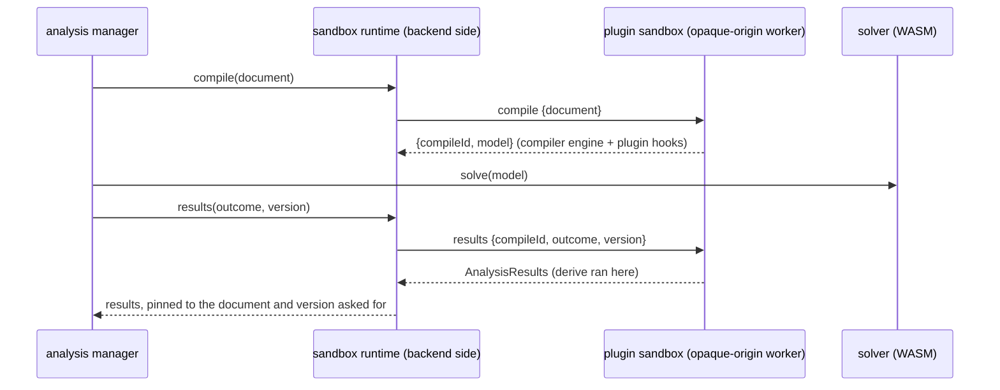

# Plugins

Every game pack has exactly one plugin (`plugin/index.js` in the `.cpack`), which works with that pack's data. A game without special mechanics uses the template's no-op plugin.

Plugins are how games differ without the core changing (open/closed principle). The `compiler` engine calls the hooks while it turns a document into the solver IR, so plugins never touch the solver or Rust.

[TOC]

## The API

The plugin contract is [[src/contracts/plugin.ts]]. Every hook is optional and pure: it gets the pack data and the document's plugin settings (`settings.plugin`, e.g. a save profile) and returns values; it never touches the document, storage or the DOM.

| Hook | When | Returns |
| --- | --- | --- |
| `nodeFields(building)` | Building the inspector, compiling | Field descriptors (`number`, `choice`, `toggle`) for nodes in that building, rendered without plugin UI code |
| `settingsFields()` | The Save profile panel, compiling | Field descriptors for document-wide settings (budgets), stored in `settings.plugin` |
| `metrics` (a property) | The inspector | Label and unit of each metric `derive` returns |
| `recipeAvailable(recipe)` | Compiling; recipe pickers and the planner later | Whether the recipe may be used (alternate unlocks, tech tree) |
| `validate(node)` | Compiling | Problems with a node's settings: warnings, or errors that leave the node out |
| `effectiveRecipe(node)` | Compiling, before the solve | The recipe as this node runs it, all modifiers applied. It must stay linear in the machine count |
| `constraints(nodes)` | Compiling, before the solve | Linear constraints over recipe nodes' machine counts (`Σ coefficient · machines op rhs`), e.g. a global budget |
| `derive(node)` | After the solve | Metrics such as power in MW; non-linear is fine here |
| `importer` | `carbonara-pack import` (maintainers) | Pack data and icons generated from the game's own files |

```ts
export default definePlugin({
  id: "satisfactory-core",
  nodeFields: (building) =>
    building.fields?.clock
      ? { clock: { kind: "number", label: "Clock", min: 1, max: 250, step: 0.0001, unit: "%", default: 100 } }
      : {},
  recipeAvailable: (recipe, { settings }) => !isAlternate(recipe) || (unlockedRecipes(settings) ?? []).includes(recipe.id),
  effectiveRecipe: ({ recipe, fields }) => ({ ...recipe, time: recipe.time / ((fields.clock as number) / 100) }),
  derive: ({ building, fields, machines }) => ({
    power: (building.power?.consume ?? 0) * ((fields.clock as number) / 100) ** 1.321929 * machines,
  }),
  metrics: { power: { label: "Power use", unit: "MW" } },
});
```

Hooks join the API when a pack needs them (YAGNI). UI contributions stay declarative: field descriptors and metric names.

### The hook pipeline

The `compiler` engine calls the hooks from one module, [[src/engines/compiler/hooks.ts]], so `compile.ts` only asks for a prepared node and the constraints. For a document it:

1. Builds the **plugin context**: the document's `settings.plugin` with the `settingsFields` checked and their defaults filled in.
2. For each recipe node: checks its **fields** against `nodeFields`. A missing value takes the default; a value of the wrong kind, out of range or not an option is replaced by the nearest allowed value or the default, with a `warning` diagnostic ("Clock speed 300 % is out of range; using 250 %"). Values of undeclared fields pass through. The hooks only ever see checked values.
3. `recipeAvailable` false → a warning ("Alternate: Pure Iron Ingot isn't unlocked"); the node still solves.
4. `validate` → the plugin's warnings and errors on the node; an error leaves the node out of the model.
5. `effectiveRecipe` → the node's rates. An answer that isn't a recipe (time not positive, amounts not finite) is an `error` diagnostic and the node is left out.
6. `constraints` over the compiled recipe nodes (in id order) → the IR's `constraints`. Terms on nodes that aren't compiled recipe nodes are dropped, constraints without terms too; a constraint with non-finite numbers or an unknown comparison is refused with an error diagnostic. Plugin constraints are hard: a solve that can't meet them is `infeasible` ([[Architecture/Solver]]), so budgets should be `atMost` against activities that may be zero.
7. After the solve, `toResults` calls `derive` per recipe node with its machine count; the metrics land in `NodeResult.derived`.

A plugin's answers are treated as input: checked, never trusted. Diagnostics carry the kind `warning` for things that don't change what's solved.

### Clients and plugins

Clients never run plugin code. `packs.describePlugin({ packId, settings })` ([[src/contracts/managers.ts]]) returns a `PluginDescription`: node fields by building id, the settings fields and the metrics, computed by `describePlugin` in the hooks module wherever the plugin runs. The inspector loads it per document ([[src/client/shell/inspector/plugin-description.ts]]) and reloads it when the document's plugin settings change.

Where a pack's plugin runs is a `PluginRuntime` ([[src/contracts/access.ts]]): `compile(document)` → the model plus a `results(outcome, version)` that maps the solution back, and `describe(settings)`. `runtimeOf(pack)` ([[src/engines/compiler/runtime.ts]]) gives built-in packs a local runtime around the same compiler functions; the analysis and packs managers only talk to runtimes.

## How mechanics map onto hooks

| Mechanic | How it's expressed |
| --- | --- |
| Satisfactory alternate recipes | `recipeAvailable` + a "Save profile" panel with the unlocked set |
| Overclocking, power shards | `nodeFields` + `effectiveRecipe` (rates) + `validate` (clock above the shard limit) + `derive` (power curve) |
| Somersloops | `effectiveRecipe` (output multiplier) + `constraints` (global budget) |
| Factorio modules and beacons | `nodeFields` (module counts, beacons) + `effectiveRecipe` (speed, productivity) + `validate` (slots) + `derive` (consumption, beacon power) |
| Factorio quality | Item variants per level, generated by the importer (`iron-plate@rare`) + a node's quality field and quality chance in `effectiveRecipe`, as expected-value outputs; recyclers are ordinary recipes, so upcycling loops are cycles the LP handles |
| Factorio Space Age | A save setting + `recipeAvailable` on the recipes' expansion tags + `validate` on the buildings' |
| Factorio heat (nuclear), not built yet | Heat becomes a flow item (MW) along heat-pipe edges; a custom `reactor` node kind applies the neighbour bonus from its layout field |
| Fluid temperatures, not built yet | Item *variants* (`steam@500`), generated by the importer |

## The save profile

A document's `settings.plugin` is the **save profile**: what the player's save has. Two parts:

- **Unlocked alternates**, a convention shared by every pack: `settings.plugin.unlocked` lists the unlocked recipe ids among the recipes tagged `alternate`; without the list every alternate counts as unlocked (a new document plans with everything). `unlockedRecipes(settings)` and `isAlternate(recipe)` in [[src/contracts/plugin.ts]] read it, for plugins' `recipeAvailable` and for the client.
- The plugin's own **settings fields** (`settingsFields`), such as a budget.

With no node selected, the inspector shows the Save profile panel ([[src/client/features/save-profile/save-profile.tsx]]): the settings fields as controls and a filterable checklist of the pack's alternates with "Unlock all" and "Lock all". Each change is one `setPluginSettings` command ([[src/contracts/commands.ts]]), which merges keys into `settings.plugin` (null removes one), so it's one undo step.

## Satisfactory

The Satisfactory plugin's mechanics are in [[packs/satisfactory/plugin/mechanics.ts]], tested against reference factories with the game's numbers in [[tools/pack-cli/satisfactory.mechanics.test.ts]]. The formulas come from the game's own data file (Satisfactory 1.1 `CommunityResources/Docs/en-US.json`, see the pack's `CREDITS.md`):

| Mechanic | Rule (Docs field) | Hooks |
| --- | --- | --- |
| Clock speed | 1 % to 100 % (`mMinPotential` 0.01, `mMaxPotential` 1.0); craft time ÷ clock | `nodeFields` (`clock`, range from the building's `fields.clock`), `effectiveRecipe` |
| Power shards | Each adds 50 % to the clock limit (`mExtraPotential` 0.5), three at most: 150 %, 200 %, 250 %. A clock above the limit runs at the limit, with a warning ("Clock speed 180 % needs 2 power shards; running at 150 %") | `nodeFields` (`shards`), `validate`, `effectiveRecipe` |
| Somersloops | A building has `mProductionShardSlotSize` slots (Smelter and Constructor 1; Assembler, Foundry, Refinery, Converter 2; Manufacturer, Blender, Particle Accelerator, Quantum Encoder 4; none for the Packager, extractors and generators). Each filled slot adds 1 / slots to the outputs (`mProductionShardBoostMultiplier`): full doubles them, inputs stay | `nodeFields` (`somersloops`), `effectiveRecipe` |
| Somersloop budget | Save settings `limitSomersloops` (toggle) and `somersloops` (count): Σ somersloops per machine × machines ≤ count | `settingsFields`, `constraints` |
| Power use | `mPowerConsumption` × boost ^ 2 (`mProductionBoostPowerConsumptionExponent`) × clock ^ 1.321929 (`mPowerConsumptionExponent`, log2 2.5). A fractional machine count is built as whole machines plus one running at the leftover share of the clock, as in the game | `derive` → `power` (MW) |
| Power generated | Generators: `mPowerProduction` × clock, fuel burnt in proportion | `effectiveRecipe`, `derive` → `powerGenerated` (MW) |
| Alternates | The save profile's unlocked list | `recipeAvailable` |

Reference numbers the tests pin: a Constructor making Iron Plates takes 30 ingots/min for 20 plates at 4 MW; at 250 % with three shards 75 → 50/min at 13.43 MW; a Smelter at 50 % makes 15 ingots/min at 1.6 MW; 2.5 Constructors draw 9.6 MW (two at 100 %, one at 50 %); a full Assembler of Reinforced Iron Plates makes 10/min from 30 plates and 60 screws at 60 MW; one somersloop in a Manufacturer making Computers gives 3.125/min at 85.9375 MW; a Coal-Powered Generator burns 15 coal and 45 m³ water/min for 75 MW, at 250 % 37.5 coal for 187.5 MW.

Known simplifications:

- The Docs file lists the Smelter with 0 somersloop slots but a boost multiplier of 1; the game's Smelter takes one, so the plugin gives it one.
- Machines with recipe-dependent power (Particle Accelerator, Converter, Quantum Encoder) use the middle of their power range, as the importer writes it.
- The somersloop budget is linear in fractional machine counts (2.5 machines with one somersloop each count 2.5, though building them takes 3).
- Extractors have no recipes in the pack yet, so their clock speed has no effect.

## Factorio

The Factorio plugin's mechanics are in [[packs/factorio/plugin/mechanics.ts]], with the game's numbers and the rules for adding effects up in [[packs/factorio/plugin/effects.ts]], tested against reference factories in [[tools/pack-cli/factorio.mechanics.test.ts]]. The numbers come from the Lua prototypes of Factorio 2.1.14 ([wube/factorio-data](https://github.com/wube/factorio-data) at tag `2.1.14`: `base/prototypes/item.lua` for the modules, `quality/prototypes/item.lua` for quality modules, `base/prototypes/entity/entities.lua` for the beacon, `quality/prototypes/quality.lua` for the quality levels) and the prototype API's `EffectReceiver` limits ([lua-api.factorio.com](https://lua-api.factorio.com/latest/types/EffectReceiver.html)); see the pack's `CREDITS.md`. What the plugin reads from the pack data is described in the Factorio pack section of [[Architecture/Game-packs]].

| Mechanic | Rule | Hooks |
| --- | --- | --- |
| Modules | Per node: how many speed, productivity, efficiency and quality modules, and one tier (1–3) for all of them. Only kinds whose positive effects the building allows (`fields.modules.effects`): no productivity in a recycler, no quality in an oil refinery. More modules than slots: the first ones in field order, with a warning | `nodeFields`, `validate`, `effectiveRecipe` |
| Effects | Add up; speed and consumption stop at -80 %, productivity and quality at 0. Effects the building doesn't allow are dropped; productivity only counts on recipes tagged `productivity` (productivity modules on others are left out, with a warning), quality not on recipes tagged `no-quality` | `effectiveRecipe` |
| Speed | Craft time ÷ (1 + speed) | `effectiveRecipe` |
| Productivity | Each result + (amount − the part `ignored_by_productivity` keeps out) × productivity: Kovarex gets +20 % of 1 U-235, not of 41 | `effectiveRecipe` |
| Built-in productivity | The building's `base-effect` (foundry, electromagnetic plant, biochamber +50 %), only on recipes that allow productivity | `effectiveRecipe` |
| Beacons | Per node: beacons in range of each machine, speed and efficiency modules per beacon (2 slots), their tier. n beacons pass on n × 1.5 (distribution effectivity) × profile[n] of one beacon's modules; profile[n] is 1/√n cut to four decimals (`profile` in the prototype), so 8 beacons give 424.20 %, not the wiki's 1.5 × √8 = 424.26 %. Their effects count against the same limits, the speed modules' -quality included | `nodeFields`, `validate`, `effectiveRecipe` |
| Quality | Per node: the quality it crafts at (normal to legendary); ingredients come at that quality, fluids have none. The quality chance Q (modules and beacons) upgrades a share Q of the products one level, and 10 % of each upgraded share one level further (`next_probability` 1, `chain_probability` 0.1 in 2.1), up to legendary: from normal 1 − Q, 0.9 Q, 0.09 Q, 0.009 Q, 0.001 Q. Productivity's extra products roll too. Recyclers work the same way | `nodeFields`, `effectiveRecipe`, `validate` (recipes without quality) |
| Space Age | Save setting `spaceAge` (on by default). Off: recipes tagged `space-age`, `quality`, `recycler` or `elevated-rails` aren't available (a warning; they still solve), and nodes in expansion buildings or using quality get a warning | `settingsFields`, `recipeAvailable`, `validate` |
| Power | Working machines: (energy usage) × (1 + consumption); every machine built (the machine count rounded up) draws its drain (1/30 of its usage for crafting machines) on top. Beacons: 480 kW each, constantly, for machines built × beacons in range ÷ machines per beacon (a node field, since beacons are shared) | `derive` → `power`, `beaconPower` (MW) |
| Fuel | Burner buildings (stone and steel furnace, biochamber) burn their energy usage × (1 + consumption) instead | `derive` → `fuel` (MW) |

Reference numbers the tests pin (per second, as in the game): an Assembling machine 3 makes 2.5 gears from 5 plates at 387.5 kW; with four speed modules 3, 7.5 gears at 1.4375 MW; with four efficiency modules 3, 87.5 kW; 2.5 of them draw 975 kW. An Electric furnace with two productivity modules 3 turns 0.4375 ore into 0.525 plates at 474 kW. A Cryogenic plant with eight productivity modules 3 runs at -80 % speed: 1.44 plastic bars from 8 petroleum gas and 0.4 coal at 11.15 MW. A Foundry casts 6 gears from 40 molten iron at 2.583 MW, with four productivity modules 3 3.04 gears from 16. An Assembling machine 3 with four productivity modules 3 and four beacons of two speed modules 3 makes 11.9 circuits from 8.5 plates and 25.5 cables, at 3.1625 MW plus 1.92 MW for the beacons. Four quality modules 3 on gears: 1.8 normal, 0.18 uncommon, 0.018 rare, 0.0018 epic, 0.0002 legendary. A Recycler with four quality modules 3 turns 12.8 uncommon gears into 5.76 uncommon, 0.576 rare, 0.0576 epic and 0.0064 legendary plates.

Known simplifications:

- The game keeps effects to 0.01 % (four decimals); the plugin doesn't round, so a total can differ in the fifth decimal.
- One module tier per node for the machine's modules and one for the beacons'; mixed tiers in one machine aren't expressible.
- Modules, beacons and machines are all of normal quality: quality's bonuses to crafting speed, module strength, beacon distribution and beacon power aren't modelled.
- Productivity research isn't modelled, so the +300 % cap (`maximum_productivity`, which no 2.1.14 recipe changes) can't be reached and isn't applied.
- Burner buildings report the energy they burn; the fuel isn't an input of their recipes yet.
- Without Space Age, recipes keep the numbers the Space Age dump gives them (Space Age changes a few base recipes).
- Heat, fluid temperatures and power generation (boilers, engines, turbines, reactors) aren't in the pack yet: steam is one item whatever its temperature, made only by acid neutralisation or taken as a raw input.
- Pollution, surface conditions (which planet a recipe needs) and spoilage aren't modelled.

## Isolation and trust

- **Built-in packs** are trusted. Their plugins run in the backend worker, alongside the compiler.
- **Third-party packs** (every installed `.cpack`, including one that stands in for a built-in pack) run in a **plugin sandbox**: a worker of its own with an opaque origin, one per pack. Only the plugin API crosses, over messages. The whole compile step for such a pack runs in the sandbox, so a solve costs one round trip for the compile and one for the results, not one per hook call.
- UI contributions are declarative only; plugins never ship React components.
- Installing a third-party pack needs an explicit trust confirmation that shows its id, version and hash. Signed packs can come later.

### The plugin sandbox



- **How it's opaque:** the backend worker starts the sandbox from a `data:` URL ([[src/platforms/web/opaque-worker.ts]]), which gives the worker a fresh opaque origin: IndexedDB and the Cache API refuse it, its requests aren't ours, and workers have no DOM. That needs the sandbox's code as one self-contained module, so `virtual:plugin-sandbox` ([[src/shells/web/plugin-sandbox.vite.ts]]) bundles [[src/shells/web/plugin-sandbox.entry.ts]] (the compiler engine and the message loop) with esbuild, in the dev server and in builds alike. Before loading the plugin, the entry deletes `fetch`, `XMLHttpRequest`, `WebSocket`, `WebTransport`, `EventSource`, `importScripts`, `Worker`, `SharedWorker` and `BroadcastChannel` along the global's prototype chain. The plugin loads from a `data:` URL inside the sandbox.
- **The message API** ([[src/shells/web/plugin-sandbox-protocol.ts]]): `load {source, data}`, `compile {document}` → `{compileId, model, blueprints}` (the blueprint graphs that can be expanded, by index in `model.blueprints`), `results {compileId, outcome, version}` → `AnalysisResults`, `blueprintResults {compileId, graph, outcome, version}` → the `AnalysisResults` of a blueprint's inside ([[Architecture/Subgraphs]], Expand), `describe {settings}` → `PluginDescription`. The sandbox keeps the latest compile of each document, since its blueprints may be expanded after its results ([[src/shells/web/plugin-sandbox-runtime.ts]]).
- **The backend side** ([[src/shells/web/plugin-sandbox.ts]]) is a `PluginRuntime`. Every call has a time limit (10 s); a sandbox that misses it is stopped and the call fails (the analysis manager shows it as an error on the document); the next call starts a fresh sandbox and loads the plugin again. Answers are untrusted: results get the document id, version and graph they were asked for, so a plugin can't overwrite another document's results, and blueprint indices that don't point into the model are dropped.
- **Wiring:** the pack library ([[src/access/packs/library.ts]]) takes an `isolate` option; with it, installed packs come back as `{ isolated: PluginRuntime }` instead of `{ plugin }`, and installing a pack loads its plugin in a sandbox first (a plugin that doesn't load there is refused). Replacing or removing a pack stops its sandbox. The backend worker ([[src/shells/web/backend.worker.ts]]) provides `isolate`; Node (the CLI, tests) has none and loads plugins directly.
- **Tests:** [[src/shells/web/plugin-sandbox.test.ts]] runs the sandbox runtime in-process and checks that compile, results, blueprint expansion and describe equal the in-worker path for the hook fixture plugin; [[e2e/plugins-sandbox.spec.ts]] installs a malicious pack whose plugin reports `origin=null dom=none fetch=undefined idb=denied caches=denied` (in the backend worker it would read `idb=open`), and solves with its hooks.

> [!WARNING]
> The sandbox keeps third-party code away from our storage and the DOM, and from `fetch`. It can't take away `import()`, so a plugin could still send the documents it compiles to a server by importing a URL. A `data:` URL worker can't be given a Content Security Policy of its own; serving the app with a CSP that limits `script-src` would close this.
